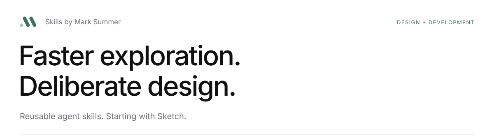
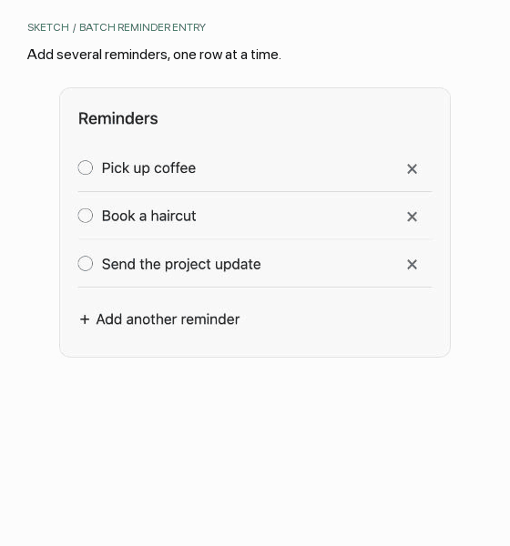
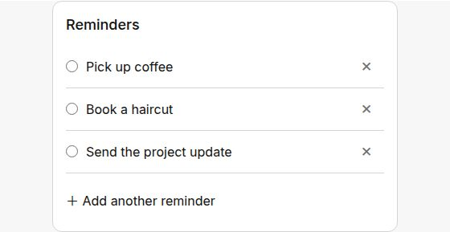
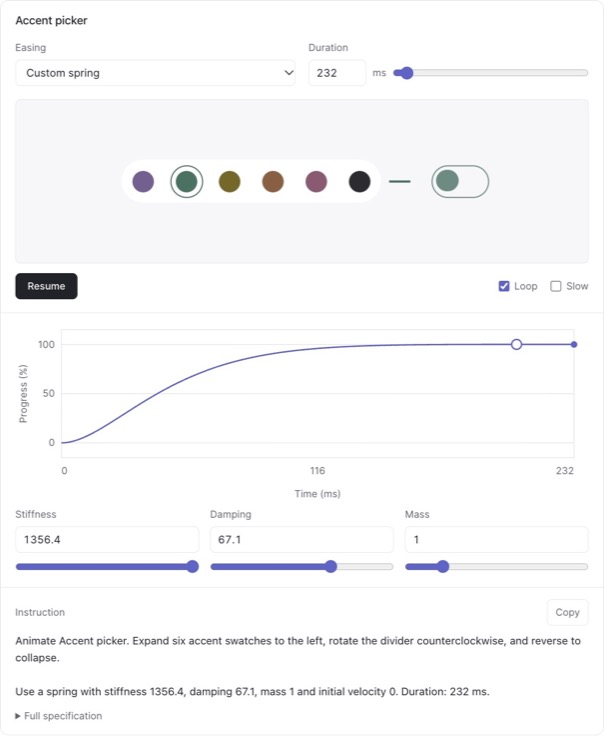

<picture>
  <source media="(prefers-color-scheme: dark)" srcset="assets/header-dark.svg">
  <source media="(prefers-color-scheme: light)" srcset="assets/header-light.svg">
  
</picture>

Five skills I use to work through interface ideas, simplify screens, and check the details.

## Choose a skill

| Skill | Use it to |
| --- | --- |
| [Sketch](sketch/README.md) | Explore an interface idea with an interactive sketch. |
| [Clean up](clean-up/README.md) | Remove clutter, tighten copy, and improve an existing layout. |
| [Tune motion](tune-motion/README.md) | Try an animation and adjust it in chat. |
| [Check design system](check-design-system/README.md) | Find where UI has drifted from the project's design system. |
| [Wireframes](wireframes/README.md) | Turn an existing design into wireframes for review. |

## Install

```sh
npx skills add marksummer/skills
```

Run this in your project, then choose Codex and the skills you want. Requires Node.js.

| Skill | What else you need |
| --- | --- |
| Sketch | The Visualize plugin in Codex for interactive previews. Without it, you get a layout outline. |
| Clean up | No extra dependency. Uses Impeccable when it is already installed. |
| Tune motion | The Visualize plugin in Codex and Python 3 for the preview generator. |
| Check design system | Available capture and rendering tools for visual comparisons. Framer audits need a connected Framer MCP. |
| Wireframes | Python 3.9 or later. Snapshot checks also need Chrome, Chromium, Edge, or Brave. |

Install Visualize separately. Each skill's usage page covers its requirements and limits.

## Sketch example

This reminder-entry sketch, based on Aside, lets you add and edit rows, press Enter for another reminder, and paste several lines at once.

<picture>
  <source media="(prefers-reduced-motion: reduce) and (prefers-color-scheme: dark)" srcset="assets/sketch-batch-dark.jpg">
  <source media="(prefers-reduced-motion: reduce)" srcset="assets/sketch-batch-light.jpg">
  <source media="(prefers-color-scheme: dark)" srcset="assets/sketch-batch-dark.gif">
  
</picture>

<details>
<summary>View a still preview</summary>

<picture>
  <source media="(prefers-color-scheme: dark)" srcset="assets/sketch-batch-dark.jpg">
  <source media="(prefers-color-scheme: light)" srcset="assets/sketch-batch-light.jpg">
  
</picture>

</details>

```text
Use $sketch to explore batch reminder entry: one editable row per reminder,
with adding, removing, and pasting multiple lines.
```

[Download the example](https://raw.githubusercontent.com/marksummer/skills/main/examples/batch-reminders.html) and open it in your browser. It runs locally without a backend. Ask to refine an element, compare options, or expand the sketch into a screen.

[Usage](sketch/README.md) · [Instructions](sketch/SKILL.md)

## Tune motion example

Try the accent picker opening and closing. Adjust the easing or spring, drag the curve, and copy the full motion specification when it feels right.

<picture>
  <source media="(prefers-color-scheme: dark)" srcset="assets/tune-motion-dark.jpg">
  
</picture>

```text
Use $tune-motion to show the accent picker expanding and collapsing
so I can tune its animation.
```

[Download the example](https://raw.githubusercontent.com/marksummer/skills/main/examples/accent-picker.html) and open it in your browser.

[Usage](tune-motion/README.md) · [Instructions](tune-motion/SKILL.md)

## License

[MIT](LICENSE). Created by [Mark Summer](https://marksummer.com).
