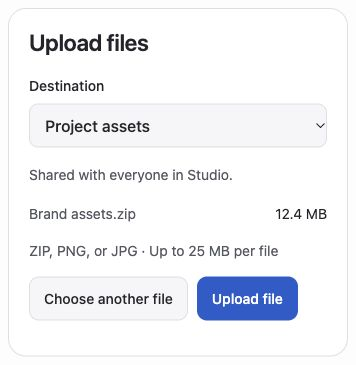
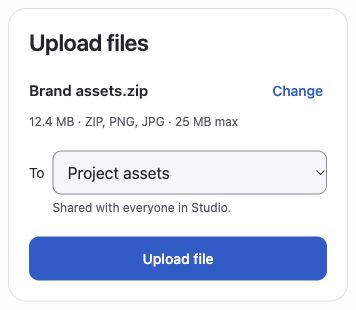
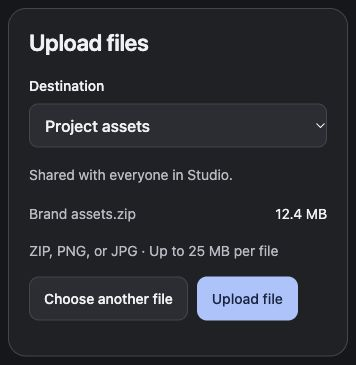
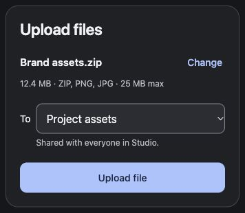

# Clean Up

Remove clutter, tighten copy, and improve an existing layout. Keep the behavior, accessibility, and visual identity that make the screen useful.

## Install

Follow the [installation steps](../README.md#install) and choose Clean Up.

You can also copy this `clean-up` folder into `~/.codex/skills/` manually. Impeccable is optional: the skill uses its distill guidance, and layout guidance when relevant, if it is already installed. It is not bundled or installed automatically.

## Use

```text
$clean-up Clean up this upload screen. Keep the existing visual identity and behavior.
```

For copy-only work:

```text
$clean-up Simplify the copy on this screen. Keep all layout, styling, and behavior unchanged.
```

Provide the screen, source, or project context. State any limits on what can change.

## What you get

A simpler screen and a compact before-and-after comparison, with a summary of the changes and what was checked. If captures are unavailable, the comparison uses source or text.

## Example

This upload-screen prototype uses simulated transfers. The cleanup was made with Impeccable available.

The revised layout groups the filename with its size and file limits, puts Change beside the file, and gives Upload file more emphasis. Destination selection and sharing information stay visible.

### Before



### After



<details>
<summary>Dark appearance</summary>

### Before



### After



</details>

[Instructions](SKILL.md) · [All skills](../README.md)
